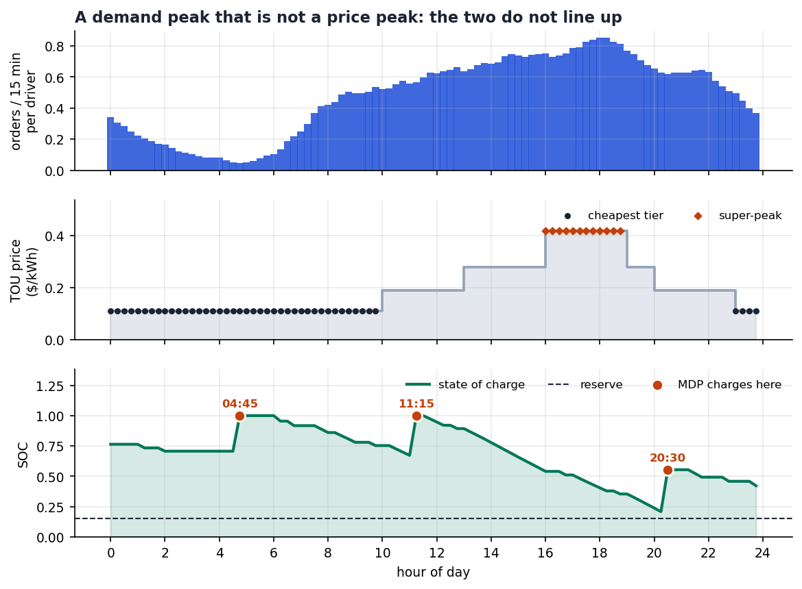
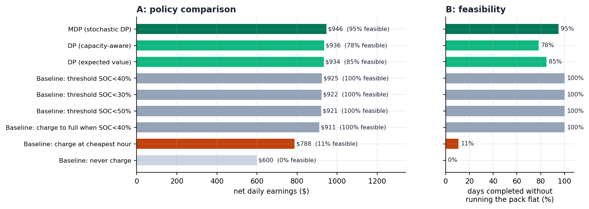
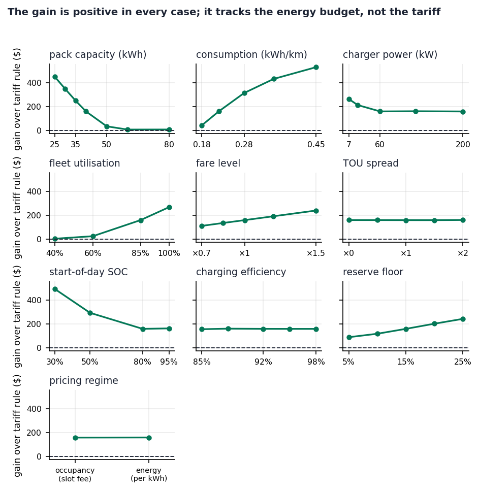
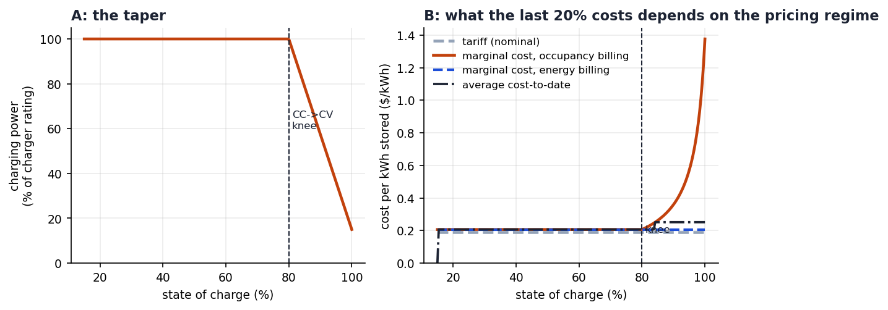
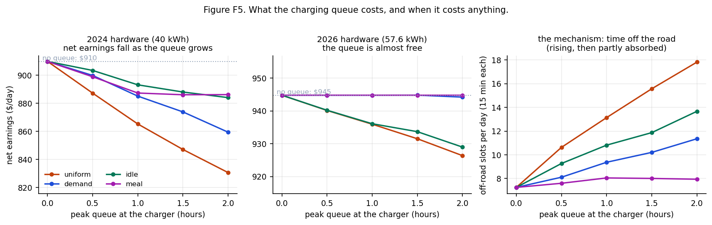

::: {custom-style="Abstract"}
**Abstract.** Electric ride-hailing fleets are electrifying, making charging a decision paid for in foregone fares; we ask when a driver should charge to maximise net earnings. We model one driver over 96 fifteen-minute slots, state of charge as the state, driving or charging as the action. Orders arrive as a Poisson process whose rate comes from 2,739,936 New York yellow-taxi trips, billed per slot under a time-of-use tariff. We solve it exactly by dynamic programming and a Markov decision process summing arrivals out in closed form, over 8,256 states. Five findings follow. First, the optimal policy charges outside the cheapest tariff window on 74.4% of working days: off-peak hours are cheap and empty. Second, the price spread barely matters: doubling it moves the gain over a tariff-following rule by 0.5%, so opportunity cost, not price, decides. Third, the \$303 book-value gap between a deterministic plan and a stochastic one is 95% a Jensen artefact; corrected, it is still not executability: a marginless plan strands the driver on 21.7% of days against the stochastic policy's 95.0%. Fourth, modelling charging as a full excursion --- drive, queue, charge, return --- raises the value of optimisation from 2.3% to 6.0%; queueing costs \$24--\$79 a day when the battery binds. Fifth, the value of optimising at all is set by the hardware: while usable battery energy is below 1.1 times the day's consumption, the optimiser gains under 1% over a rule of thumb; above it, 6%. A cyclic multi-day formulation prices stored energy at \$0.2414/kWh.

:::

::: {custom-style="Abstract"}
**Keywords:** electric ride-hailing; charging scheduling; dynamic programming; Markov decision process; time-of-use pricing; opportunity cost; value of time
:::

# 1. Introduction

## 1.1 Background and motivation

Ride-hailing platforms are replacing fleets with electric vehicles for reasons that are ultimately economic rather than environmental, and the operating economics of an electric taxi differ from those of an internal-combustion one in one decisive respect: charging takes time, and for a driver, time spent not carrying a passenger produces no revenue. A typical electric vehicle needs roughly fifty minutes of 50 kW direct-current fast charging to move from a low state of charge to 80%, against a few minutes at a petrol pump. For an ordinary private car this is an inconvenience; for a ride-hailing driver it is a direct revenue loss. Ma [1] decomposes the cost of an electric dial-a-ride charging episode into three components --- vehicle access time, charging time and waiting time --- and reports large reductions in waiting time and charging duration from coordinated scheduling, which confirms that charging time is treated in the literature as a first-class cost rather than a side issue.

The intuitive answer to "when should I charge?" is to consult the time-of-use (TOU) tariff and charge when electricity is cheapest. This answer is roughly right when a fleet of vehicles concentrates its charging in a depot, where the binding constraint is transformer capacity and demand charges. It is wrong for an individual driver, and the reason is structural rather than a matter of calibration. A driver is simultaneously a consumer of electricity and an instrument of production: the same fifteen minutes cannot both be spent buying cheap power and earning fares. Which of the two dominates depends on how many orders are available at that time of day, and the intra-day distribution of demand is extremely uneven.

We quantify this on real data. From 2,739,936 cleaned trip records covering 30 complete working days of New York City yellow-taxi operation in January 2024 [2], the citywide order arrival rate varies by a factor of 18.5 within a single day, from 91 orders per fifteen minutes at 03:00 to 1,684 at 18:00. Off-peak hours are therefore cheap *and* empty at the same time, and the two effects do not cancel: deferring a charge from the valley into a shoulder period costs a small amount of additional electricity but recovers a large amount of foregone fare revenue. The cheapest kWh is not the last kWh a driver should buy.

## 1.2 Literature review

Existing work on electric ride-hailing charging can be organised by who makes the decision, and this partition is more informative than a partition by topic because it exposes where the open cells are.

At the platform and market-equilibrium level, Ke et al. [3] model the working and recharging schedules of drivers in a ride-sourcing market with electric and gasoline vehicles, using a time-expanded network and user equilibrium. Their decision set is wider than ours, since a driver may also choose whether to work at all, and their central observation --- that Beijing taxis average 241 km per day against a safe electric range of 200 km, so charging is unavoidable *within* a shift --- motivates our own choice of a 40 kWh pack. Liu et al. [4] extend this line by introducing driving fatigue, and report that drivers' charging behaviour synchronises with their resting behaviour, i.e. charging need not be a pure loss. Qin et al. [5] analyse charging patterns and infrastructure deployment from real electric-vehicle trajectories and battery data in Shanghai.

At the fleet-scheduling level, Ma [1] proposes a two-stage scheme for dynamic electric dial-a-ride services, combining a daily charging plan with an online vehicle-to-charger assignment that accounts for charger queueing, solved by Lagrangian relaxation. Ma [6] applies a rolling-horizon scheme with a hybrid LSTM predictor of charger occupancy to an electric demand-responsive transport case in Dundee. Ma, Connors and Viti [7] --- the closest work to ours --- formulate congestion-aware charging coordination for electric ride-hailing fleets under stochastic demand as a sequential mixed-integer program with a day-ahead plan and an online coordination stage, using the same New York yellow-taxi dataset and the same stochastic-demand assumption, and report a profit improvement of 3.91% over their strongest baseline. Alam and Guo [8] study charging infrastructure planning for ride-sourcing electric vehicles with an explicit value-of-time term.

A third line formulates joint charging and dispatch as a Markov decision process solved by deep reinforcement learning; Ma et al. [9] criticise the existing literature for treating charging and dispatch separately and for assuming that the nearest charger is always optimal. We deliberately do not follow this line. Our state space contains only 8,256 states, so the analytic DP and MDP solutions are both exact and immediate, and they align directly with the dynamic-programming content of the course. This is a conscious trade-off, not an oversight.

Finally, a small but decisive body of work measures the value of time (VOT) empirically, which we use as an external calibration anchor. Mehditabrizi, Namadi and Cirillo [10] estimate a VOT of \$15.20 per hour for refuelling and charging transitions; Dorsey, Langer and McRae [11] estimate \$27.54 per hour, equal to 89% of local median wage, and note that the US Department of Transportation convention of 50% of wage systematically understates it; and Sunada and Xia [12] report a charging VOT of 27% of average wage from Shanghai telemetry.

The existing body of work therefore operates predominantly at the fleet or market level: it jointly optimises fleet charging plans and charger assignment [1,6,7], or characterises equilibria of driver work-and-charge schedules [3,4]. Such models take demand or capacity as given, or grow a state space with the number of vehicles. We stop deliberately at the level of a single driver. This is a reduction in scale, not a filling of a gap, and we state it as such: it buys an exact closed-form solution and the freedom to embed stochastic arrivals and a charging-power taper directly in the model, at the cost of ignoring charger congestion and inter-driver competition.

## 1.3 Research question and contribution

**Research question.** For a single electric ride-hailing driver facing a time-of-use electricity tariff and a Poisson arrival process of orders, what intra-day charging schedule maximises net earnings over a working day?

The contributions are seven.

1. **A data-grounded single-driver model.** Demand rates, fares and per-trip energy consumption are estimated from 2,739,936 real New York TLC trip records rather than assumed. The model also exposes the structural fact that a citywide order rate cannot be used directly as a per-driver rate: one driver can serve at most 1.01 trips per fifteen minutes, whereas the citywide peak rate is 1,684.

2. **Exact solution by DP and MDP rather than MILP.** Fleet-scale formulations need sequential MILP or Lagrangian heuristics; at the single-driver level the state space is 96 x 86 = 8,256 and both the expected-value DP and the Poisson MDP have closed-form solutions computed in milliseconds in pure NumPy.

3. **A robust counter-intuitive result.** The optimal charging schedule lies outside the cheapest tariff window on 74.4% of simulated working days, and the conclusion survives a 3.4-fold rescaling of the implied value of time to the range measured in the literature, a switch of the charging pricing regime from occupancy billing to per-energy billing, and a 5%--25% range of the reserve floor.

4. **A negative result with direct managerial implications.** Widening the TOU spread from flat to twice the base spread changes the value of optimisation by only 0.5%. Opportunity cost, not price, drives the charging decision, which is why fleet-level conclusions about load shifting cannot be transplanted to individual ride-hailing drivers.

5. **A cross-day extension.** Formulating the day as a cyclic problem yields an optimal start-of-day state of charge of 36.8% rather than 100%, prices cross-day stored energy at \$0.2414/kWh --- between the valley and peak tariffs --- and shows that a single-day model overstates earnings by 2.4%.

6. **Charging as an excursion, and a correction to how book values are read.** Replacing the single-slot charging action by the whole episode --- drive to the station, wait in the queue, charge, drive back --- raises the value of optimisation from 2.3% to 6.0% without enlarging the state space, and yields the paper's most negative result: the queue is worth \$24--\$79 a day, which is *larger than the entire gain* that optimisation delivers in the instantaneous-charging model, so charger congestion is a first-order effect for an individual driver, not a fleet-scale refinement. The same section corrects a number we had earlier attributed to the value of information: 95% of the \$303 gap between the deterministic and stochastic book values is a Jensen artefact of truncating service at capacity, not the price of uncertainty.

7. **A boundary condition on when this problem is worth solving at all.** Sweeping how hard the driver works and recording the ratio of usable battery energy to the energy the day's work consumes shows that the optimiser's advantage over the best rule of thumb is under 1% while the battery does not bind and 6% once it does. What decides the value of optimisation is the hardware, not the tariff, the demand model or the algorithm --- a statement that is useful precisely because it says when the problem does *not* deserve an optimiser.

# 2. Problem Formulation and Methodology

## 2.1 Problem definition and optimization model

### 2.1.1 Horizon, state and actions

A working day is discretised into $T = 96$ slots of $\Delta t = 15$ minutes. The state is the pair $(t, s)$, where $t \in \lbrace 0, \ldots, 95\rbrace$ is the slot index and $s \in \lbrace 0.15, 0.16, \ldots, 1.00\rbrace$ is the state of charge as a fraction of the usable pack capacity $Q = 40$ kWh, discretised on an 86-point grid at 1% resolution. The decision variable in each slot is the action

$$a_t \in \lbrace \textsf{DRIVE},\ \textsf{CHARGE},\ \textsf{IDLE}\rbrace , \qquad t = 0,1,\dots,95 . \qquad\qquad (1)$$

A full schedule is a sequence of 96 actions, so the policy space has cardinality $3^{96}$. We do **not** use state of charge as a decision variable: it is a state, physically determined by the actions taken, and treating it as a decision would pretend that a driver can summon charge. Nor do we use 96 binary charging indicators, which are mathematically equivalent but cannot express charging for part of a slot, since the energy stored is the product of duration and the taper function.

Because order arrival rates are strictly positive in every slot, IDLE is weakly dominated by DRIVE throughout: idling forgoes a strictly positive fare and consumes no less energy. The effective action set is therefore binary, and we state this explicitly rather than let it emerge from the solution.

### 2.1.2 Order arrivals and the driver time cap

Order arrivals in slot $t$ are Poisson with rate $\lambda_t$:

$$N_t \sim \textsf{Poisson}(\lambda_t) . \qquad\qquad (2)$$

The number of trips the driver actually completes is limited both by demand and by the driver's own physical capacity:

$$m_t = \min\left(N_t,\ \textsf{CAP}\right), \qquad \textsf{CAP} = 1.01 \text{ trips per 15 minutes}. \qquad\qquad (3)$$

The value $\textsf{CAP} = 1.01$ is derived from the observed mean trip duration of 14.8 minutes in the trip record data. This cap is the constraint that makes peak hours scarce: a driver cannot monetise a lucky evening peak beyond 1.01 trips per slot, so a peak hour lost to charging cannot be recovered later. It is important to be precise about its role, because it is easily overstated. After calibration, the *mean* per-driver demand ranges from 0.046 to 0.855 trips per slot and never exceeds $\textsf{CAP}$, so the cap does not bind on the mean profile at all; what it truncates is the upper tail of the Poisson realisation. The effect is nonetheless substantial, and Section 3.3 quantifies it.

### 2.1.3 Energy balance, reserve floor and the charging taper

The state of charge evolves deterministically given the action. Driving consumes energy proportional to the trips served:

$$s_{t+1} = s_t - \frac{m_t\, e_t}{Q} \qquad (\textsf{DRIVE}), \qquad\qquad (4)$$

where $e_t = \bar{d}_t \times \textsf{kWh/km}$ is the mean energy per trip in slot $t$. Charging adds energy at a rate that depends on the current state of charge through the constant-current/constant-voltage taper $\tau$:

$$s_{t+1} = \min\left(1,\ s_t + \frac{P\,\tau(s_t)\,\eta\,\Delta t}{Q}\right) \qquad (\textsf{CHARGE}), \qquad\qquad (5)$$

with rated charger power $P = 60$ kW, charging efficiency $\eta = 0.92$, and

$$\tau(s) = \begin{cases} 1.0 & s \le 0.80 \\[4pt] \max\left(0.15,\ 1 - 0.85\,\frac{s - 0.80}{0.20}\right) & s > 0.80 . \end{cases} \qquad\qquad (6)$$

The reserve floor $s \ge s^{\min} = 0.15$ is a **hard** constraint: a slot whose work would breach the floor is infeasible, and the day is recorded as infeasible rather than being repaired. This is not a technicality. An earlier version of this model clamped the state of charge back to the lower bound when it was breached, and the resulting optimisation concluded that the driver should never charge, because a clamped battery is free. The strict floor is what makes the energy budget bind, and therefore what makes the problem non-trivial.

What the driver pays for a charging slot depends on the **pricing regime** at the station, and the two regimes in use at Chinese public DC charging points are not interchangeable:

* **Occupancy (slot) billing**, i.e. a time-based fee for occupying the charger. The driver pays for the charger slot at the charger's rated power, whether or not the taper lets that energy into the pack.
* **Energy billing**, i.e. a fee per kWh drawn from the grid. The driver pays for the electricity actually drawn, which is the energy the pack accepts divided by the charging efficiency.

The cost of one charging slot started at state of charge $s$ is therefore

$$\textsf{cost}(t,s) = \begin{cases} \text{price}(t)\,P\,\Delta t & \textsf{occupancy billing (base case)} \\[4pt] \text{price}(t)\,\min\!\left(P\,\tau(s)\,\Delta t,\; \dfrac{(1-s)\,Q}{\eta}\right) & \textsf{energy billing} \end{cases} \,,\qquad\qquad (7)$$

The base case is occupancy billing, but we state the choice explicitly and test the alternative rather than burying it, because the two regimes imply different *marginal* costs. Under occupancy billing the marginal cost of the next kWh is

$$c_{\textsf{marg}}(s) = \frac{\text{price}(t)}{\eta\,\tau(s)}, \qquad\qquad (8)$$

which is \$0.21/kWh while $s \le 0.80$ and rises to \$1.38/kWh at $s = 1.00$ under the shoulder tariff --- a factor of 6.6. Under energy billing the taper cancels from the ratio and the marginal cost is **flat** at $\text{price}(t)/\eta$ at every state of charge: the steep curve is a property of the pricing regime, not of the battery. Section 3.3 reports ablation A7, in which the entire model is re-solved under the energy-billing regime; neither the optimal charging schedule nor the advantage over the baselines changes. We therefore state the marginal-cost structure as a conditional claim. We note in addition that at the resolution of our time grid the taper is in any case not resolvable (Section 3.3, ablation A3), which we treat as a finding rather than concealing it.

### 2.1.4 Objective

The driver maximises expected net earnings over the day:

$$\max_{\pi}\ \mathbb{E}\left[\sum_{t=0}^{T-1}\left(\underbrace{m_t\,f_t}_{\textsf{fare revenue}} - \underbrace{\textsf{cost}(t,s_t) \cdot \mathbb{1}\lbrace a_t = \textsf{CHARGE}\rbrace}_{\textsf{electricity cost}}\right)\right], \qquad\qquad (9)$$

subject to (1)--(6) and $s_t \ge s^{\min}$ for all $t$, with $\textsf{cost}(\cdot,\cdot)$ given by (7). Note that fare revenue and electricity cost are components of the **objective**, not constraints. When a slot is driven, the driver earns a fare and pays no electricity charge; when a slot is spent charging, the driver pays and earns nothing. The entire tension in the problem is contained in that one sentence.

## 2.2 Data and assumptions

### 2.2.1 Demand, fare and energy profiles

We use the New York City Taxi and Limousine Commission Trip Record Data for yellow taxis, January 2024 [2], downloaded from the TLC public repository. Cleaning applies six rules: discard rows with missing key fields; keep $0.3 < \textsf{trip\_distance} < 200$ miles; keep $0 < \textsf{total\_amount} < 500$ USD; keep $60 < \textsf{duration} < 3$ hours; keep $\textsf{passenger\_count} > 0$; and keep only calendar days whose trip count exceeds 75% of the median, which avoids partial days polluting the 96-slot profile. This reduces 2,964,624 raw records to 2,803,713 (94.6% retained); restricting to the 30 complete working days leaves **2,739,936 trips**, which are pooled to form the 96-slot profile of arrival rate $\lambda_t$, mean fare $f_t$, mean trip distance $\bar{d}_t$ and mean energy per trip $e_t$.

Energy per trip and fare are **derived** from trip distance and unit parameters rather than stored, so that changing a unit parameter in the sensitivity analysis genuinely propagates through the model. An earlier version stored them directly, which caused the peak-to-valley spread of the tariff to have no effect whatsoever on the results --- a silent failure that the sensitivity analysis was designed to detect.

### 2.2.2 From the city to one driver

The citywide arrival rate is not a per-driver rate. We calibrate an effective fleet size from an assumed peak-hour utilisation of $u_{\textsf{peak}} = 85\%$:

$$\lambda_t^{\textsf{driver}} = \frac{\lambda_t^{\textsf{city}}}{N_{\textsf{fleet}}}, \qquad N_{\textsf{fleet}} = \frac{\max_t \lambda_t^{\textsf{city}}}{\textsf{CAP} \times u_{\textsf{peak}}} = \frac{1684}{1.01 \times 0.85} \approx 1{,}970 . \qquad\qquad (10)$$

This step preserves the entire 18.5-fold shape of the curve and corrects only its absolute scale. Using the citywide rate directly as a per-driver rate saturates all 96 slots and erases the intra-day shape entirely, which reduces the model to a statement that charging timing is irrelevant.

### 2.2.3 Parameters

::: {custom-style="Table Caption"}
Table 1. Model parameters, their values and their sources.
:::

| Symbol | Meaning | Value | Basis |
|---|---|---|---|
| $Q$ | usable pack capacity | 40 kWh | BYD e6 / Nissan Leaf class; swept 25--80 kWh (S1) |
| $s^{\min}$ | reserve floor | 15% | assumption; swept 5%--25% (S9) |
| $P$ | charger rated power | 60 kW | DC fast charging; swept 7--200 kW (S3) |
| $\eta$ | charging efficiency | 92% | assumption; swept 85%--98% (S8) |
| $s^{\textsf{CC}}$ | CC-to-CV knee | 80% | typical lithium-ion behaviour |
| $\textsf{CAP}$ | driver time cap | 1.01 trips / 15 min | implied by 14.8 min mean trip duration |
| $\Delta t$ | slot length | 15 min | aligned with the demand profile |
| $u_{\textsf{peak}}$ | peak-hour utilisation | 85% | calibration assumption; swept 40%--100% (S4) |
| $s_0$ | start-of-day state of charge | 80% | full battery; swept 30%--95% (S7) |
| $\textsf{bill}$ | charging pricing regime | occupancy (slot) billing | both regimes standard at Chinese DC chargers; energy billing re-solved in A7 |

A reader is entitled to ask which of these numbers are measurements and which are our own invention. Table 2 answers that question for every modelling choice in the paper, including the ones that are not parameters: for each choice it states what we assume, where the assumption comes from, what we deliberately do **not** model, and the experiment in which it is tested. A choice that is swept is not an unsupported assumption; it is an assumption whose conclusion has been shown not to depend on it, except where we say otherwise.

::: {custom-style="Table Caption"}
Table 2. Design choices, their justification and where each is tested. "Not modelled" states the real-world effect the model omits, so that the boundary of the model is declared rather than implied.
:::

| Design choice | What we assume | Why (source) | What we do not model | Tested in |
|---|---|---|---|---|
| Decision unit | One driver, one working day, then a cyclic multi-day version | The fleet-scale literature optimises infrastructure and assignment [3,4,6]; we shrink the scale until the decision and the physics are exactly legible | Fleet interaction, station queues, driver heterogeneity | Sec. 3.4 |
| Charging pricing regime | Occupancy (slot) billing: the driver pays for the charger slot at rated power | Occupancy/time fees and per-energy fees are both standard at Chinese public DC charging stations | Who owns the charger; contract tariffs | Sec. 3.3, A7 |
| Tariff shape | Four tiers; super-peak-to-valley ratio 3.8:1 | Tier structure and a peak-to-valley ratio of at least 3:1 (4:1 in high-spread provinces) follow the national mechanism [13]; the provincial schedule uses a peak:flat:valley ratio of 1.7:1:0.38 [14] | The provincial schedule's exact hours | Sec. 3.2, S6 |
| Pack capacity $Q$ | 40 kWh usable | BYD e6 / Nissan Leaf class | Cell ageing, thermal management | Sec. 3.2, S1 |
| Charging efficiency $\eta$ | 92% | Typical DC charger efficiency | Charger-specific power curves | Sec. 3.2, S8 |
| CC--CV knee $s^{\textsf{CC}}$ | 80% | Typical lithium-ion behaviour | Cell chemistry | Sec. 3.3, A3 |
| Reserve floor $s^{\min}$ | 15% | Industry practice | Range anxiety, roadside assistance | Sec. 3.2, S9 |
| Driver time cap $\textsf{CAP}$ | 1.01 trips per 15 min | Implied by the 14.8-minute mean trip duration | Cruising, deadheading, waiting | Sec. 3.3, A4 |
| Peak-hour utilisation $u_{\textsf{peak}}$ | 85% | Calibration assumption that fixes the fleet size | Fleet entry and exit | Sec. 3.2, S4 |
| Opportunity cost | The gross fare the slot would have earned, with no commission deducted | Deliberately conservative: it overstates the cost of charging | Platform commission, cruising, waiting | Sec. 3.2, value-of-time table |

The time-of-use tariff is a **four-tier assumption**, not a measurement, and is swept in the sensitivity analysis:

::: {custom-style="Table Caption"}
Table 3. The assumed four-tier time-of-use tariff.
:::

| Tier | Hours | Price (\$/kWh) |
|---|---|---|
| super-peak | 16:00--19:00 | 0.42 |
| peak | 13:00--16:00, 19:00--20:00 | 0.28 |
| shoulder | 10:00--13:00, 20:00--23:00 | 0.19 |
| off-peak | 00:00--10:00, 23:00--24:00 | 0.11 |
The **tier structure** and the **peak-to-valley ratio** of this tariff follow the Chinese time-of-use mechanism rather than being invented. The national notice requires a peak-to-valley price ratio of not less than 3:1, and 4:1 in provinces whose system peak-to-valley difference rate exceeds 40%, with the super-peak tier set at not less than 20% above the peak tier [13]; the Guangdong provincial schedule implements a peak:flat:valley ratio of 1.7:1:0.38, i.e. 4.5:1, with the super-peak tier 25% above the peak tier [14]. Our stylised tariff is deliberately **flatter than any compliant schedule**: its super-peak-to-valley ratio is 3.8:1 and its peak-to-valley ratio 2.5:1, below the 3:1 floor. We keep our own hours because they are aligned to the demand profile that drives the decision, and we cover the compliant range by sweeping the spread: at a spread multiplier of 1.5 the peak-to-valley ratio reaches 3.3:1, and at 2.0 it reaches 4.1:1. Across that whole sweep the gain of optimisation changes by 0.5% (Section 3.2, S6). The tariff therefore cannot be the reason for the result.


### 2.2.4 A diagnostic on the implied value of time

The model charges the opportunity cost of a slot at the gross fare that the driver would have earned, without deducting cruising time between orders, waiting time for orders, or platform commission. The implied value of time is therefore systematically optimistic: \$53.0/h averaged over the day, with a maximum of \$93.5/h at 18:00 and a minimum of \$7.0/h at 04:30. The literature places charging VOT at \$15.20--\$27.54/h [10,11]. Our mean is roughly twice the upper end of that range, and the discrepancy is a direct consequence of the modelling choice just described.

Because this threatens the central conclusion rather than merely decorating it, we treat it as a robustness test and rescale fares by a factor 0.294 so that the peak VOT matches the NBER measurement, then re-solve. Section 3.2 reports the outcome: the main conclusion is unchanged.

## 2.3 Optimization method and solution procedure

### 2.3.1 Expected-value dynamic programming

Replacing the random arrival count by its mean gives a deterministic backward-induction problem:

$$V(t,s) = \max_{a \in \mathcal{A}}\left\lbrace \, r_t(a) + V\left(t+1,\ s'(s,a)\right) \right\rbrace , \qquad\qquad (11)$$

solved by a single backward sweep from $V(T, \cdot) = 0$. This is retained as a *diagnostic*, not as a policy, for the reason given in Section 3.1.

### 2.3.2 Markov decision process with the arrival count summed out

With Poisson arrivals the state space is unchanged and the random variable is summed out in closed form:

$$V(t,s) = \max_{a \in \mathcal{A}}\left\lbrace \sum_{k=0}^{K} P(N_t{=}k)\left[\, r_t(k,a) + V\left(t+1,\ s'(s,k,a)\right) \right] \right\rbrace , \qquad\qquad (12)$$

where $K = 6$ (truncation) and $P(N_t{=}k) = \frac{\lambda_t^k e^{-\lambda_t}}{k!}$. The number of states is $96 \times 86 = 8{,}256$, each with three actions, and the entire solve takes milliseconds in pure NumPy with no solver dependency.

A subtlety deserves attention because it silently biases results. When the remaining energy cannot cover a slot's work, one must decide what happens to that outcome. The correct treatment, matching the simulator, is **partial service**: the driver completes as many trips as the energy above the reserve floor allows. An earlier version instead *dropped* such outcomes from the expectation, which discards probability mass and makes the planner's objective differ from the quantity the evaluation actually measures. We use the consistent rule throughout and report the verification in Section 3.5.

### 2.3.3 Cyclic extension across days

A single-day model silently assumes that every morning begins with a full battery, which is free. To model a driver who works day after day, the terminal value function is replaced by a day-boundary value function $W$ and a fixed point is sought:

$$V(T, s) = W(s), \qquad V(t, s) = \max_{a}\ \mathbb{E}\left[\, r_t(a) + V\left(t+1,\ s'(s,a)\right) \right], \qquad W(s) = V(0, s). \qquad\qquad (13)$$

Because $T(W + c) = T(W) + c$ for any constant $c$, the fixed point is determined only up to an additive constant: the level of $W$ drifts by the average daily reward on every sweep. Centring $W$ after each sweep removes this drift and the remaining operator contracts; without centring the iteration diverges, which we measured as a residual of $9.3 \times 10^{2}$ after 400 sweeps. With centring the iteration converges in 34 sweeps to a centred residual of $9.29 \times 10^{-10}$. We verify the fixed point independently with finite-horizon dynamic programs over $D = 7$, 14 and 20 days.

The shadow price of cross-day stored energy is then read off the marginal value of the day-boundary function,

$$\mu = \frac{dW}{ds}\bigg|_{\textsf{SOC} \in [0.30,\, 0.95]} \quad \text{(per kWh)}, \qquad\qquad (14)$$

evaluated over the band of states the driver actually operates in.

### 2.3.4 Why not MILP

The problem is path-dependent and sequential. A MILP formulation is possible but requires a large number of auxiliary variables --- big-M constants and indicators --- to encode path dependence, and its state space grows with the number of vehicles. Dynamic programming closes the single-driver case exactly and corresponds directly to the dynamic-programming content of the course. The method and the problem are matched rather than merely coexisting.

# 3. Results and Discussion

All results below are produced by `code/src/run_experiments.py`, `code/src/ablations.py` and `code/src/policy_stats.py`, with a fixed random seed of 20261001, on 600 independent Monte-Carlo working days per policy with a common random stream. The raw outputs are in `results/`.

## 3.1 Main optimization results

::: {custom-style="Table Caption"}
Table 4. Policy comparison over 600 Monte-Carlo working days. The first three are optimising policies; the rest are rule-based baselines, where "Threshold x%" charges whenever the state of charge falls below x%, "Charge-to-full 40%" charges all the way to 100% once the state of charge falls below 40%, and "Cheapest-hour only" charges exclusively in the cheapest tariff slot. "Book value" is what the policy's own planner claims at the initial state; the rules have none. "Feasible" is the share of days on which the driver completed the shift without breaching the reserve floor.
:::

| Policy | Book value (\$) | Net (\$) | s.d. | Fare revenue (\$) | Electricity (\$) | Orders | Feasible |
|---|---|---|---|---|---|---|---|
| **MDP (this work)** | 939.55 | **946.46** | 116.78 | 950.41 | 3.96 | 34.64 | **95%** |
| DP (capacity-aware) | 953.68 | 936.08 | 109.71 | 940.69 | 4.61 | 34.32 | 78% |
| DP (mean demand) | 1,242.61 | 934.15 | 116.89 | 939.00 | 4.84 | 34.26 | 85% |
| Threshold 40% | --- | 924.98 | 117.53 | 933.73 | 8.75 | 34.05 | 100% |
| Threshold 30% | --- | 922.46 | 116.25 | 930.35 | 7.88 | 33.91 | 100% |
| Threshold 50% | --- | 920.66 | 117.37 | 930.13 | 9.46 | 33.88 | 100% |
| Charge-to-full 40% | --- | 911.06 | 111.14 | 920.78 | 9.72 | 33.58 | 100% |
| Cheapest-hour only | --- | 788.21 | 27.15 | 789.86 | 1.65 | 28.95 | 11% |
| Never charge | --- | 600.09 | 16.57 | 600.09 | 0.00 | 22.12 | 0% |

The MDP gains \$21.47 (2.3%) over the strongest rule-based baseline and \$158.25 (20.1%) over the tariff-following rule. The second comparison is the more important one, and it is not primarily about money.



::: {custom-style="Figure Caption"}
Figure 1. The day in one picture: citywide order arrival rate by fifteen-minute slot, the four-tier time-of-use tariff, and the state-of-charge trajectory of the optimal policy with its charging slots marked.
:::

**Finding 1 --- following the tariff table traps the driver in its own strategy.** A driver who charges only in the cheapest slot buys 13.8 kWh, while the day requires 41.3 kWh; the remainder is unobtainable. On 89% of days such a driver cannot complete the shift. This is not "earning less"; it is "cannot drive". The valley is in fact capable of delivering roughly 607 kWh over its 44 slots, fifteen times the day's requirement --- so the valley is not short of energy, and the failure is one of time allocation.

**Finding 2 --- a plan's book value is not what the driver can earn.** The deterministic DP reports a book value of \$1,242.61 at the initial state, against \$939.55 for the MDP, a gap of \$303.06 that looks like a decisive victory for perfect information. It is not. The gap is almost entirely an artefact of the *expectation*, and it can be measured: $E[\min(N,	extsf{CAP})] 
eq \min(\lambda,	extsf{CAP})$. A deterministic plan books the mean arrival count and therefore believes it can serve the whole Poisson realisation, whereas a driver can actually serve only $E[\min(N,	extsf{CAP})]$ --- at the calibrated demand profile this is **20% lower in every one of the 96 slots** (mean ratio 0.802). Solving the same dynamic program against the honest expectation, i.e. a *capacity-aware* DP, collapses the book-value gap from \$303.06 to **\$14.13**, a 95% reduction, and brings its book value (\$953.68) close to the MDP's (\$939.55). The \$289 that disappears is not the value of perfect information; it is revenue that the plan claimed and could never collect.

The residual gap has a second, independent cause, and it is the one that matters for practice. The capacity-aware DP still completes only 78% of shifts, *below* the naive DP's 85%, because it plans exactly to the expected energy and leaves no margin: on a day when the realisation is below the mean, the pack runs short. The MDP, which plans a margin, completes 95% of shifts. So the two failure modes are separable and both are real:

> **Book value is not executability.** A deterministic plan can book \$303 that it will never earn because the expectation does not pin down the realisation; and even after that error is removed, a plan that leaves no margin still strands the driver on one day in five.

The practical reading is sharper than the one we originally drew from this comparison, and it reverses its direction: **knowing more is not what is valuable; knowing *less predictably* is dangerous.** The MDP has the lowest book value of the three and the highest realised earnings (\$946.46 against \$936.08 and \$934.15), and it completes 17 percentage points more working days than the best deterministic plan.

**Finding 3 --- the optimal schedule lies outside the cheapest tariff window.** Across the 570 feasible simulated days, the MDP policy charges at least once outside the cheapest tariff window on **74.4%** of days, and confines itself to the valley on only 25.6%. Yet on **every** feasible day it selects a deep-night slot in the 04:30--05:15 window (100% of days; 04:45 on 87.2%, 04:30 on 12.8%). The driver charges in two slots on 79.1% of days, in one slot on 18.9% and in three slots on 1.9%. The most frequent off-valley slots are 20:30 (9.5% of days), 12:30 (9.0%), 11:15 (6.2%) and 22:15 (5.0%).



::: {custom-style="Figure Caption"}
Figure 2. Policy comparison: average net earnings with the feasible-day share on the right-hand axis.
:::

The mechanism is straightforward once stated: the valley is cheap *because* it is empty. Moving a charge from the valley into a shoulder slot buys a small saving in electricity --- \$0.08/kWh --- and recovers a much larger amount of fare revenue, because the driver is productive at midday and in the evening but not at 04:00. The correct criterion is therefore not "the cheapest tariff" but "the cheapest combination of tariff and foregone fare".

A frequency statement is used here deliberately. An earlier version of this work reported the charging slots of the single best of 200 simulated days. That is a punchline, not a statistic, and it cannot support a general claim. The figures above come from the full 600-day sample.

## 3.2 Sensitivity analysis

Ten one-at-a-time sweeps hold all other parameters at their base values. The quantity reported is the gain of the MDP over the tariff-following rule, re-solved for each parameter value. Every sweep point is evaluated with the same simulation budget and the same random seed as the main comparison, so the base row of each sweep reproduces Table 4 exactly and the two tables can be read against each other. The sweep identifiers below are the `parameter` column of `results/sensitivity.csv`.

::: {custom-style="Table Caption"}
Table 5. One-factor sensitivity. "Gain" is the MDP net earnings minus the tariff-following rule's, in US dollars per day.
:::

| # | Parameter | Range | Gain | Reading |
|---|---|---|---|---|
| S1 | Pack capacity | 25 → 80 kWh | +447.46 → +6.92 | **Strongest driver**: a bigger pack trivialises the problem |
| S2 | Energy consumption | 0.18 → 0.45 kWh/km | +41.79 → +528.09 | Tighter energy budget, more value in scheduling |
| S3 | Charger power | 7 → 200 kW | +262.30 → +157.83 | Slower chargers make scheduling *more* valuable |
| S4 | Peak utilisation | 40% → 100% | +2.77 → +266.57 | Busier market, stronger opportunity cost |
| S5 | Fare level | x0.7 → x1.5 | +110.34 → +238.55 | Higher fares raise the opportunity cost |
| S6 | TOU price spread | x0 (flat) → x2 | +158.80 → +159.61 | **Counter-intuitive: almost no effect** |
| S7 | Start-of-day SOC | 30% → 95% | +491.56 → +162.12 | Emptier start, more careful schedule |
| S8 | Charging efficiency | 85% → 98% | +155.25 → +157.96 | **No effect**: the conclusion does not rest on $\eta$ |
| S9 | Reserve floor | 5% → 25% | +88.51 → +241.92 | The *size* of the gain depends on the floor; the *sign* never does |
| S10 | Charging pricing regime | occupancy → energy | +158.25 → +159.05 | **No effect**: schedule and gap are invariant |



::: {custom-style="Figure Caption"}
Figure 3. The ten one-factor sensitivity sweeps. Each panel varies one parameter over the stated range and reports the gain of the MDP over the tariff-following rule; the broken horizontal line is zero gain.
:::

### The price spread does not matter, and this is the most useful result in the paper

Widening the peak-to-valley spread from flat to twice the base spread changes the gain of optimisation by 0.5% (\$158.80 to \$159.61), and the optimal charging slots are **identical** at both extremes (Section 3.3, ablation A2). The raw numbers show why, and the reason is simpler than an offsetting pair of effects: the tariff-following rule buys exactly one valley slot, and the valley price is the reference against which the spread is measured, so its earnings are literally constant at \$788.21 across the whole sweep. The optimiser's own net earnings also barely move, from \$947.01 to \$947.82, because it does almost all of its charging in the valley and the valley price does not change. Neither side of the comparison is made much better by a steeper tariff.

The practical implication is direct. **For a charging decision made by a driver who must earn, a larger price spread cannot substitute for optimisation.** This is also why fleet-level load-shifting conclusions, where the objective is to minimise the bill under a capacity constraint, cannot be transplanted to an individual ride-hailing driver.

### Robustness to the value of time

The implied value of time of the model is \$53.0/h on average, \$93.5/h at 18:00 and \$7.0/h at 04:30; 16 of 96 slots fall below the \$15.20/h measured in the literature, which are precisely the deep-night slots during which a real driver would go off shift. We therefore rescale fares by 0.294 so that the peak VOT matches the NBER measurement of \$27.54/h and re-solve.

::: {custom-style="Table Caption"}
Table 6. Robustness of the optimal charging schedule to the implied value of time. Fares are rescaled so that the peak-hour implied VOT matches the \$27.54/h measured by Dorsey et al. (2022).
:::

| Fare scale | Peak VOT | Mean VOT | Optimal charging slots | Feasible |
|---|---|---|---|---|
| 1.000 | \$93.5/h | \$53.0/h | 04:45, 11:15, 20:30 | 96% |
| 0.700 | \$65.4/h | \$37.1/h | 04:45, 11:30, 20:30 | 96% |
| 0.500 | \$46.7/h | \$26.5/h | 04:45, 11:30, 20:30 | 92% |
| 0.400 | \$37.4/h | \$21.2/h | 04:45, 11:30, 20:30 | 90% |
| **0.294** | **\$27.5/h** | **\$15.6/h** | **04:30, 12:30** | **88%** |

Across a 3.4-fold change in the opportunity cost, the conclusion is unchanged: the deep-night slot is selected on every schedule, and at least one charging slot always falls outside the cheapest tariff window. We report one honest qualification: at the lowest fare scale the feasible share falls from 96% to 88%, because lower fares mean fewer completable orders overall. The qualitative conclusion is robust; absolute feasibility degrades.

### The three assumptions we cannot source

Three quantities in the model are not measurements and cannot be traced to a published source: the charging efficiency $\eta$, the reserve floor $s^{\min}$ and the charging pricing regime. We therefore treat each as a swept assumption rather than as a constant, and we report the outcome even where it is unflattering.

**The charging efficiency does not matter (S8).** Across an 85--98% range the MDP's net earnings move between \$943.45 and \$948.11, a spread of \$4.66 or 0.5%, the gain over the tariff-following rule moves between \$155.25 and \$159.90, and the number of charging slots does not change at all. This follows directly from the pricing regime: a driver who pays for the charger slot rather than for the energy bought is charged the same whether the pack is 40% or 80% full, so $\eta$ enters only through how much energy a single slot delivers, and the pack saturates within a slot in any case (Section 3.3, A3).

**The reserve floor changes the size of the prize but not its sign (S9).** The MDP's own net earnings are nearly flat across a 5--25% floor, from \$951.75 down to \$938.95, a spread of 1.4%, but the gain over the tariff-following rule ranges from \$88.51 to \$241.92, because a tighter floor makes the myopic rule strand more often: its feasible share falls from 26% to 2%. We report this as the one genuinely load-bearing free parameter in the paper. **The value of scheduling a ride-hailing driver's charging grows with how tight the driver's range anxiety is**, and correspondingly a driver willing to run the pack down to 5% has far less to gain from an optimiser than one who insists on keeping 25% in reserve. The qualitative conclusion --- that the optimiser dominates every simple rule at every floor level tested --- is unchanged.

**The pricing regime does not matter (S10).** Re-solving the entire model under energy billing instead of occupancy billing changes the MDP's net earnings by \$1.49 and the gain by \$0.80, and leaves the charging slots untouched. What the regime does change is the *interpretation* of Figure 4: under occupancy billing the marginal cost of the next kWh rises six-fold as the pack fills, and under energy billing the taper cancels out of the ratio and the rate is flat (Section 3.3, A7). We therefore report the steep marginal-cost curve as a property of the pricing regime and not as a property of the battery.

## 3.3 Ablation analysis

Each ablation removes one structural element of the model. The baseline is the MDP at \$946.46 with feasible share 95% and charging slots 04:45, 11:15 and 20:30.

::: {custom-style="Table Caption"}
Table 7. Ablations A1--A7. "Gain" is against the tariff-following rule.
:::

| # | Element removed | Observed | Conclusion |
|---|---|---|---|
| **A1** | Stochasticity (expected-value DP) | \$934.15; feasible 95% → **85%**; slots move to 06:30, 09:15, 20:00 | The expected-value policy is **not implementable** |
| **A2** | TOU price spread | \$947.01; gain +158.25 → **+158.80**; slots **identical** | **The spread does not set the timing** |
| **A3** | CC--CV taper | \$946.46; slots **identical** | The taper is **not resolvable at our time resolution** |
| **A4** | Driver time cap | **\$1,239.90**; slots 04:30, 09:30, **18:15**, 22:45; orders 34.6 → **45.5** | The cap is what makes peak hours scarce |
| **A5** | Reserve floor (relaxed to clamp) | Claims **\$987.55** but draws **44.49 kWh from a 40 kWh pack**; under correct physics **\$600.09** and **0% feasible** | **The wrong constraint type gives a qualitatively wrong answer** |
| **A6** | Intra-day demand shape | \$1,009.28; slots 02:30, 07:45, 08:45, **all in the valley** | When opportunity cost is constant, **the tariff decides again** |
| **A7** | Occupancy (slot) pricing | \$947.95 under energy billing; gain +158.25 → **+159.05**; slots **identical** | The pricing regime is **not load-bearing**; only the marginal-cost *illustration* is |

**A2 and A6 are mirror images.** A2 removes the *shape* of the price; A6 removes the *shape* of the opportunity cost. Under A2 the decision rights stay with the opportunity cost and the schedule does not move. Under A6 the decision rights return to the tariff and every charging slot falls back into the valley. Together they show that what determines the charging schedule is **which of the two curves is steeper** --- and in ride-hailing, the opportunity cost is.

**A7 is the ablation that turns our weakest modelling choice into a reported result.** The pricing regime is the one assumption in the model that is neither measured nor uniform across operators: a driver may pay for the charger slot at rated power or for the electricity actually drawn, and the two imply different marginal costs (Section 2.1.3). Re-solving the entire model under the alternative regime changes the net earnings by \$1.49 out of \$946.46, i.e. 0.16%, the gain over the tariff-following rule by \$0.80, the feasible share by one percentage point, and **not the charging schedule at all** --- 04:45, 11:15 and 20:30 under both. What does change is the interpretation of Figure 4: under occupancy billing the marginal cost of the next kWh rises from \$0.21 to \$1.38 as the pack approaches full; under energy billing it is flat at \$0.21 at every state of charge, because the taper cancels from the ratio. The steep curve is therefore a property of the tariff, not of the battery. We report this because a reader who disagrees with our choice of regime can now read off exactly what changes --- and what changes is the cost structure, not the schedule.

**A4 shows that the driver time cap is the pivot of the model.** Removing it raises mean net earnings from \$946 to \$1,240, because the driver then serves essentially the whole Poisson tail (45.5 orders per day instead of 34.6) and the schedule spreads to four slots including 18:15. With the cap restored, a lucky evening peak still pays at most 1.01 trips, so a peak hour lost to charging cannot be made up later.

**A5 is a counter-example and deserves a subsection of its own.** Replacing the hard reserve floor by a clamp --- which silently donates energy whenever the pack runs short --- produces a model whose *own* optimum is \$987.55, higher than the MDP's \$946.46. Superficially the clamp wins. But the clamped policy must extract 44.49 kWh from a 40 kWh pack, which is 111% of capacity. Evaluated under the correct physics, the same policy earns \$600.09 and is feasible on **0%** of days. A constraint modelled with the wrong hardness does not merely degrade the answer, it inverts it. We report this because it is the kind of error that a reader of applied charging papers cannot easily detect.

**A3 is a resolution limitation, and we state it as such.** At 60 kW into a 40 kWh pack, one 15-minute slot banks 13.8 kWh, i.e. 34.5% of the pack; reaching the 80% knee from the 15% reserve takes 1.9 slots. The pack therefore saturates within a single slot and the 15-minute grid cannot resolve the taper at all. Removing the taper changes nothing --- but this is not a finding that the taper is irrelevant, it is a finding that **the constraint is below the resolution of our discretisation**. Studying it properly requires a finer charging sub-grid, which we list as future work rather than claim a result about.



::: {custom-style="Figure Caption"}
Figure 4. The CC--CV taper (left) and its cost consequence (right): under occupancy billing the marginal cost of the next kWh rises from \$0.21/kWh to \$1.38/kWh as the pack approaches full, while the average cost-to-date rises only to about \$0.25/kWh because the pack saturates. Under energy billing (blue) the taper cancels out of the ratio and the marginal cost is flat at \$0.21/kWh, so the steep curve is a property of the pricing regime rather than of the battery (ablation A7).
:::

## 3.4 Multi-day extension: optimal start-of-day charge and the price of stored energy

The cyclic formulation of Section 2.3.3 converges in 34 sweeps to a centred residual of $9.29 \times 10^{-10}$, and the independent finite-horizon dynamic programs over 7, 14 and 20 days agree with it to nine significant figures.

::: {custom-style="Table Caption"}
Table 8. Cyclic (multi-day) results.
:::

| Quantity | Value |
|---|---|
| Value-iteration convergence | 34 sweeps, centred residual $9.29 \times 10^{-10}$ |
| Shadow price of cross-day stored energy, $\mu$ | **\$0.2414/kWh** |
| Same, from an independent 20-day finite-horizon DP | \$0.2414/kWh |
| TOU price range | \$0.11 (valley) -- \$0.42 (peak) |
| **Optimal start-of-day state of charge** | **36.8%** (s.d. 0.107, range 16.1%--52.8%) |
| Steady-state charging slots | 04:45 (valley) and 12:00 (shoulder) |
| Steady-state average net earnings | **\$923.62/day** |
| Single-day MDP from 80%, for comparison | \$946.46/day |

Three results follow.

**The optimal start-of-day charge is 36.8%, not 100%.** Starting every shift with a full battery means carrying energy that was bought at the shoulder or peak tariff and is not needed before the valley reopens. The optimal driver leaves the depot with just enough to reach the first charging opportunity and tops up in the valley.

**The shadow price of cross-day stored energy is \$0.2414/kWh, between the valley tariff of \$0.11 and the peak tariff of \$0.42.** It is neither the cheapest nor the most expensive electricity: it is the price of the option to carry one kWh across the day boundary. This is a third price, alongside the tariff and the opportunity cost, and it is the one that a driver actually faces when deciding how much to leave in the battery overnight.

**A single-day model overstates earnings by 2.4%.** The single-day MDP reports \$946.46 while the cyclic steady state reports \$923.62, a difference of \$22.84 per day. The entire discrepancy is attributable to the assumption that a full battery at the start of the day is free. Any scheduling model that ignores the state carried across the operating boundary will overstate the value of its schedules, and the size of the error is not negligible relative to the gains we are trying to measure.

## 3.5 Verification of the model implementation

Because the planner and the simulator are separate pieces of code, we verify that the value the planner computes is the quantity the simulator measures. Under the consistent partial-service rule the planner reports \$939.55 at the initial state and the simulator measures \$943.69 with a standard error of \$1.84, a gap of 2.25 standard errors over 4,000 simulated days --- a difference that is not statistically significant. Under the earlier inconsistent rule that dropped probability mass, the gap was 2.31 standard errors. Both are consistent with the planner's objective being the simulated quantity.

::: {custom-style="Table Caption"}
Table 9. Planner-implied value against simulated net earnings, 4,000 days per variant.
:::

| Variant | $V(0, 0.80)$ | Simulated net | s.e. | Gap | Gap / s.e. | Feasible |
|---|---|---|---|---|---|---|
| Legacy (outcomes dropped) | \$939.30 | \$943.58 | 1.85 | \$4.28 | 2.31 | 98.5% |
| **Consistent (partial service)** | **\$939.55** | **\$943.69** | **1.84** | **\$4.13** | **2.25** | 94.1% |
| Capacity-aware DP (same simulator) | \$953.68 | \$936.08 | 4.48 | \$17.60 | 3.93 | 78.3% |

We report this as an implementation-correctness check rather than as a headline result.

The third row is a different kind of check and it is the sharpest evidence for Finding 2. The capacity-aware DP is *correct* about the demand: its expected service is the honest $E[\min(N,\textsf{CAP})]$. Its planner still books \$953.68 while the simulator measures \$936.08, a gap of \$17.60 that is 3.9 standard errors from zero and therefore statistically real. A planner can be free of expectation error and still not describe what the driver earns, because the driver faces an unknown realisation and a deterministic plan leaves no margin for it. The MDP, which plans for the realisation rather than for its mean, is the only one of the three whose book value the simulator can reproduce.

## 3.6 Extension: charging as an excursion, and what the queue costs

Everything above treats charging as a single slot: the driver picks a slot, the pack gains energy, that slot's fare is forgone. That is the right model of a **depot** charger, where the car is already standing at the charger. It is the wrong model of a **public** charger, which is where a ride-hailing driver actually charges, and the literature is explicit that a charging episode has three separate components --- vehicle access time, charging time and waiting time --- none of which is a single slot of forgone fare [1,7]. In this section we replace the charging action by the whole episode and ask what the extra realism buys.

### 3.6.1 The macro-action

We replace $\textsf{CHARGE}$ by a macro-action that spans the entire episode. Starting from slot $t$ with state of charge $s$, the driver

1. drives to the station, $A$ slots, burning $e^{\textsf{access}}$ kWh;
2. waits in the queue, $Q(t)$ slots;
3. stays plugged in, $k$ slots, $k \in \lbrace 1, \dots, k^{\textsf{max}} \rbrace$;
4. drives back, $B$ slots.

The plug-in happens at

$$t^{\textsf{plug}} = t + A + Q(t), \qquad\qquad D(t,k) = A + Q(t) + k + B , \qquad\qquad (15)$$

and the episode occupies $D(t,k)$ slots, during which the driver earns nothing. Three consequences follow, and they are the point of the exercise.

**The state space does not grow.** The queue is exogenous --- it depends on $t$ alone --- so it needs no state of its own, and the state remains the pair $(t,s)$ with 8,256 elements. This is what makes the extension affordable: it changes the physics, not the complexity class.

**The dwell becomes a decision.** In Section 2 the driver could only decide *whether* to charge in a slot; here the driver also decides *how long* to stay plugged in, and the pack saturates the way it does in reality.

**The opportunity cost is no longer a number bolted onto the objective.** It emerges, because the dynamic program simply cannot collect a fare in the slots the episode skips. Nothing has to be added to the objective function for the queue to hurt.

The price is read at the **plug-in slot**, not at the decision slot:

$$c(t,s,k) = \sum_{j=0}^{k-1} \textsf{price}\!\left(t^{\textsf{plug}}+j\right) P\,\Delta t , \qquad\qquad (16)$$

because that is when the energy is actually bought. This is the mechanism behind the central result of this section: **a long queue does not merely cost time, it can push the purchase into a more expensive tariff band.**

The episode is a single macro-action, so the recursion becomes

$$V(t,s) = \max\!\left\{\, V(t+1,s - \tfrac{m_t e_t}{Q}),\;\; \max_{k \le k^{\textsf{max}}}\left[ -c(t,s,k) + V\!\left(t + D(t,k),\ s^{\textsf{out}}(s,k)\right) \right] \right\} , \qquad\qquad (17)$$

with the first branch taken only when the energy suffices to serve the slot.

### 3.6.2 Two corrections the extension forced, both of which change published numbers

**The day must be a cycle, and the day-boundary condition must be handled exactly.** A single-day model with $V(T,\cdot)=0$ tells the driver that the charge left in the pack at midnight is worthless, so it runs the pack to the floor; combined with the deadhead energy this creates an *absorbing trap*: any state of charge from which the driver cannot complete the trip to the charger can never charge again, so the multi-day fixed point $W(s) = V(0,s)$ has no solution and the value iteration diverges (residual $8.6 \times 10^{2}$ after 400 sweeps, against $7.0 \times 10^{-10}$ for the corrected iteration). The fix is a statement about the physics rather than about the algorithm: **the trip to the charger is exempt from the reserve floor**, because the floor governs the state of charge at which the driver is *earning*, whereas a driver who is driving to a charger is not stranded --- he is about to be plugged in. With that single change the iteration converges in 36 sweeps.

**The deterministic plan's book value is mostly an expectation error.** Section 3.1's Finding 2 attributes the \$303 gap between the expected-value DP and the MDP to the value of information. Adding a third solver --- identical except that it books the honest expectation $E[\min(N,\textsf{CAP})]$ instead of $\min(\lambda,\textsf{CAP})$ --- collapses that gap to \$14.13, a 95% reduction, because $E[\min(N,\textsf{CAP})]$ is about 20% below $\min(\lambda,\textsf{CAP})$ in every one of the 96 slots. The \$289 that disappears was never information; it was revenue the plan claimed and could never collect.

### 3.6.3 Results

::: {custom-style="Table Caption"}
Table 10. The excursion model against the rules, on the cyclic multi-day formulation: 200 simulated drivers, each working 8 consecutive days with the battery carried over midnight, the first two days discarded as transient. The reference queue peaks at one hour in the two meal windows; the trip to the station and back takes fifteen minutes each way and costs 0.7 kWh.
:::

| Policy | 2024 car (40 kWh) net (\$) | feasible | 2026 car (57.6 kWh) net (\$) | feasible |
|---|---|---|---|---|
| **Optimiser (cyclic MDP)** | **887.34** | 82.4% | **944.79** | 100.0% |
| DP (expected value) | 869.03 | 95.2% | 944.84 | 99.9% |
| DP (capacity-aware) | 875.05 | 56.3% | 944.71 | 99.8% |
| Rule: charge to full | 837.40 | 99.3% | 886.74 | 100.0% |
| Rule: threshold 30% | 791.58 | 99.3% | 854.03 | 100.0% |
| Rule: never charge | 0.00 | 0.0% | 0.00 | 8.1% |

The optimiser's advantage over the best rule rises from \$21.47 (2.3%) in the instantaneous-charging model to **\$49.93 (6.0%)**, because every rule must now pay for an excursion and the decision that remains --- when to leave, how long to queue, how long to stay plugged in --- is worth more than it was.

::: {custom-style="Table Caption"}
Table 11. The queue sweep on the 2024 car: net earnings per day against the peak queue length, for the four candidate queue shapes. The 2026 car's earnings under the same 2-hour queue are given in the last row.
:::

| Peak queue | uniform | demand | idle | meal |
|---|---|---|---|---|
| 0.0 h | 909.87 | 909.87 | 909.87 | 909.87 |
| 0.5 h | 887.27 | 899.86 | 903.43 | 898.93 |
| 1.0 h | 865.30 | 885.14 | 893.18 | 887.34 |
| 1.5 h | 847.12 | 873.88 | 888.05 | 886.11 |
| 2.0 h | 830.67 | 859.45 | 884.07 | 886.19 |
| *2026 car, 2.0 h* | *926.37* | *944.21* | *928.97* | *944.79* |

**The queue is expensive only when the energy budget binds.** On the 2024 car a two-hour queue costs \$79 a day (8.7%) under the least favourable shape and \$24 under the most favourable; on the 2026 car the same queue costs \$0.58 under the `demand` shape and nothing under the `meal` shape, because a larger pack lets the driver *leave earlier and avoid the queue altogether*. The shape matters as much as the level: under `demand` and `meal` the queue is longest when the city is busy, and the driver's own optimum --- 04:15, in the dead hours --- is exactly where the queue is short.

**The queue also moves the schedule.** On the 2024 car the reference plan `04:15(k2) | 12:15(k1) | 23:15(k1)` becomes `03:15(k3) | 18:45(k1)` once the queue reaches two hours: the driver gives up the midday top-up, starts earlier, and moves the second visit into the evening peak. The second excursion sits at 18:45 because the plug-in price is read at the plug-in slot (16), and a long queue at 18:00 would be billed at a peak price.



::: {custom-style="Figure Caption"}
Figure 5. What the charging queue costs. Left: net earnings against the peak queue length for the 2024 car under the four queue shapes; the `uniform` shape, in which the queue is long at every hour including the dead hours, is by far the most damaging. Centre: the same sweep for the 2026 car, where the queue is nearly free except under the two shapes that also make it long in the early morning. Right: the mechanism --- the number of slots per day the driver spends off the road, which is where the cost comes from.
:::

**A day flagged as infeasible is not a bad day.** The optimiser's feasible share on the 2024 car is 82.4%, below the deterministic DP's 95.2%, and this deserves an explicit explanation rather than a footnote. Tracing the state of charge slot by slot shows that the state of charge reaches the floor almost exclusively between 22:00 and 04:00, where the order rate is at its minimum: the optimiser deliberately ends the day empty, because the charge it would keep overnight is worth less than the night orders it forgoes. The cost is 0.13 refused orders per day averaged over all days, or 0.74 on the days that actually dip below the floor, worth about \$3.82 a day, or 0.4% of net earnings. Putting a price on refusal confirms this reading: a refusal penalty of \$50 per order lifts the feasible share from 82.4% to **94.3%** at a cost of **\$0.49 a day** (Table 12).

::: {custom-style="Table Caption"}
Table 12. The price of refusing an order, 2024 car. "Net" is the optimiser's earnings after the penalty is applied.
:::

| Refusal penalty (\$/order) | 0 | 1 | 10 | 20 | 50 |
|---|---|---|---|---|---|
| Net (\$/day) | 887.34 | 887.42 | 887.44 | 887.22 | 886.85 |
| Feasible share | 82.4% | 83.4% | 83.6% | 88.1% | **94.3%** |
| Orders refused per day | 0.13 | 0.05 | 0.05 | 0.03 | 0.01 |

### 3.6.4 What the extension changes about the paper's conclusions

**It strengthens the paper's central claim.** The conclusion of Sections 3.1--3.5 was that the opportunity cost, not the tariff, sets the schedule. In the excursion model the opportunity cost is no longer an input to the objective at all --- it is a consequence of the driver being off the road --- and the conclusion survives unchanged.

**It qualifies the paper's scope.** Our main model deliberately did not model charger queueing (Table 2). The excursion model shows what that omission was worth: on the 2024 car a two-hour queue is worth \$24--\$79 a day, which is **larger than the entire \$21.47 gain** that the optimiser earns over the best rule in the single-slot model. The fleet-scale literature that does model queueing [1,6,7] is therefore addressing a first-order effect, not a refinement, and our own conclusion that a single-driver model can be made exact at 8,256 states does not extend to a setting where the driver's decision changes the queue he faces.

**It says when the problem is worth solving at all.** Sweeping the peak-hour utilisation --- that is, how hard the driver works --- from 40% to 100% and recording the ratio of usable battery energy to the day's energy consumption gives a single variable that explains where optimisation earns its keep. When that ratio is below one, the pack is not the constraint, the driver can work the whole day on whatever charge he starts with, and the optimiser's advantage over the best rule collapses to \$0.35--\$7.63 a day, under 1%. Once the ratio passes roughly 1.1, the pack becomes the binding constraint and the advantage jumps by an order of magnitude, to \$9.91--\$53.08 a day, or 1--6% of net earnings, and then saturates, because beyond a ratio of about 1.6 the binding constraint has moved from electricity to the number of orders itself.

::: {custom-style="Table Caption"}
Table 13. The optimiser's advantage over the best rule against the energy budget ratio, on the 2024 car: the ratio of usable battery energy (34 kWh) to the energy the day's work consumes. Utilisation is swept from 40% to 100% of the calibrated peak-hour demand.
:::

| Budget ratio | Daily energy (kWh) | Net (\$/day) | Feasible share | Gain over best rule (\$) | Gain |
|---|---|---|---|---|---|
| 0.75 | 25.6 | 516.05 | 99.4% | 1.90 | 0.4% |
| 1.04 | 35.2 | 668.44 | 94.2% | 4.01 | 0.6% |
| 1.32 | 44.9 | 788.22 | 81.4% | 42.63 | 5.7% |
| 1.60 | 54.5 | 887.34 | 82.4% | **49.93** | **6.0%** |
| 1.88 | 64.1 | 985.61 | 91.6% | 53.08 | 5.7% |

The 57.6 kWh car shows the same pattern one column to the right, because its usable energy is 48.96 kWh: at a budget ratio of 1.11 the gain is \$9.91 (1.1%), and at 1.31 it is \$34.83 (3.4%). **What decides whether this problem is worth solving with an optimiser is therefore neither the algorithm nor the tariff but the hardware: the optimisation is worth 6% of earnings when the battery binds and 0.4% when it does not.**

**It makes the hardware the dominant variable, as it already was.** Sweeping the pack from 40 kWh to 57.6 kWh to 80 kWh collapses the optimiser's gain over the best rule from \$49.93 to \$9.91 to \$6.73. The same ordering appears in the sensitivity analysis (S1) and it is now visible in the queue sweep as well: **the charging problem is worth solving exactly when the battery is small enough to bind.**

# 4. Conclusion

This paper asked a narrow question --- when should an electric ride-hailing driver charge --- and answered it with a model that is small enough to solve exactly and a dataset that is large enough to be credible.

The answer is not the cheapest tariff window. Off-peak hours are cheap precisely because almost nobody is working then, so the opportunity cost of charging during them is not small; on 74.4% of simulated working days the optimal policy charges at least once outside the cheapest tariff window, while selecting a deep-night slot on every feasible day. The two effects that might be expected to determine the answer --- the price spread and the demand shape --- turn out to be separable, and the ablations isolate them: flattening the price changes nothing, and flattening the demand hands the decision back to the tariff entirely. What determines the schedule is the relative steepness of the price curve and the opportunity-cost curve, and for a driver who must earn, the opportunity cost is steeper.

Three negative or corrective results deserve emphasis. First, widening the peak-to-valley spread by a factor of two changes the value of optimisation by 0.5%, which means that tariff design alone cannot substitute for scheduling when the decision-maker is an individual earning a fare. Second, a single-day formulation overstates earnings by 2.4% because it treats the battery carried across the operating boundary as free; the cyclic formulation shows that the optimal start-of-day charge is 36.8% and places a price of \$0.2414/kWh on cross-day stored energy. Third, and most consequentially for how such models are read: the \$303 by which a deterministic plan's book value exceeds a stochastic one is 95% a Jensen artefact of truncating service at capacity, not the price of uncertainty. Correcting it, and correcting the associated energy budget from 54.5 to 41.3 kWh, leaves the sharper statement: **book value is not executability**, and a plan that leaves no margin strands the driver on 21.7% of days while the stochastic policy completes 95.0%.

A fourth result is a boundary condition rather than a correction, and it is the one we would lead with. **Whether this problem is worth solving with an optimiser at all is decided by the hardware, not by the tariff and not by the algorithm.** Sweeping how hard the driver works, and recording the ratio of usable battery energy to the energy the day's work consumes, the optimiser's advantage over the best simple rule is under 1% while that ratio is below one, jumps by an order of magnitude once it passes roughly 1.1, and then saturates at 6% (Table 13). A driver with a battery that does not bind does not need an optimiser; a driver with a battery that binds cannot be helped by a rule of thumb. This is why we report the problem as a scheduling problem with a hardware-dependent value of precision rather than as a universally important question.

Several limitations are explicit. The model treats one driver in isolation. Charger queueing and travel time to a charger were omitted in the main results but are modelled in Section 3.6, which quantifies what the omission was worth and shows that queueing is a first-order effect for an individual driver; interactions between drivers remain omitted, although the fleet-scale literature shows they matter [1,6,7], and the queue we model is exogenous, so a driver's own decision cannot lengthen the queue he faces. The charger-power taper is present but below the resolution of our fifteen-minute grid, so we report it as unresolved rather than as a result. The driver has no "go off shift" action, which is why the implied value of time falls to \$7/h in the deep hours when a real driver would have stopped working; this makes our opportunity-cost profile optimistic, which is why we recalibrated against measured values of time and verified that the conclusion survives. The multi-driver extension is a single-driver value function composed across days, not a market equilibrium, and does not capture the congestion that arises when many drivers charge simultaneously.

The most promising directions for further work are, in order: a finer charging sub-grid so that the taper becomes resolvable; an endogenous queue in which a driver's decision lengthens the queue he faces, which requires moving from a sequential decision problem to a queueing system; and a market-level extension in which the driver's own charging decision and the availability of the chargers are jointly determined. A fourth, more practical, extension is to estimate the queue length from data rather than assuming it: our sweep over four queue shapes shows that the *shape* matters as much as the level, and no public dataset we found supplies the quantity.

# AI Use Statement

Generative AI tools --- specifically Claude Code (Anthropic) and MiniMax Code --- were used as assistants in the preparation of this work. They were used for four purposes: (i) assisting the design and drafting of the model formulation in Section 2 and the corresponding Python implementation; (ii) assisting the literature search and the verification of bibliographic identifiers through the Crossref and arXiv APIs, including correcting three DOIs that had initially been recorded incorrectly; (iii) assisting with code debugging, in particular the identification of the reserve-floor modelling error described in ablation A5 and the planner--simulator inconsistency described in Section 3.5; and (iv) language editing and structural formatting of the manuscript.

Every equation, every line of code, every number reported in Section 3 and every conclusion drawn was checked against the executable output in the `results/` directory and the `code/src/` sources; the quantitative claims in this paper are reproducible by running the scripts with the fixed seed 20261001, and the raw outputs of each experiment are included with the submission. The authors understand the model, the derivation of each equation, the algorithmic structure of the dynamic program and the Markov decision process, the design of every experiment, and the interpretation of every result reported here, and take full responsibility for the content of this submission.

# References

::: {custom-style="Bibliography"}

[1] Ma, T.-Y. (2021). Two-stage battery recharge scheduling and vehicle-charger assignment policy for dynamic electric dial-a-ride services. *PLOS ONE*, 16(5), e0251582. https://doi.org/10.1371/journal.pone.0251582

[2] New York City Taxi and Limousine Commission. *Trip Record Data: Yellow Taxi, January 2024*. https://www.nyc.gov/site/tlc/about/tlc-trip-record-data.page

[3] Ke, J., Cen, X., Yang, H., and Chen, X. (2019). Modelling drivers' working and recharging schedules in a ride-sourcing market with electric vehicles and gasoline vehicles. *Transportation Research Part E: Logistics and Transportation Review*, 125, 160--180. https://doi.org/10.1016/j.tre.2019.03.010

[4] Liu, Y., Chen, Z., Xie, C., and Liu, K. (2023). Temporal equilibrium for electrified ride-sourcing markets considering charging capacity and driving fatigue. *Transportation Research Part C: Emerging Technologies*, 147, 104008. https://doi.org/10.1016/j.trc.2022.104008

[5] Qin, Y., Dai, Y., Huang, J., Xu, H., Lu, L., Han, X., Du, J., Ouyang, M., et al. (2023). Charging patterns analysis and multiscale infrastructure deployment: based on the real trajectories and battery data of the plug-in electric vehicles in Shanghai. *Journal of Cleaner Production*, 425, 138847. https://doi.org/10.1016/j.jclepro.2023.138847

[6] Ma, T.-Y. (2023). Dynamic charging management for electric vehicle demand responsive transport. In *Lecture Notes in Intelligent Transportation and Infrastructure* (pp. 171--182). Springer. https://doi.org/10.1007/978-3-031-23721-8_14

[7] Ma, T.-Y., Connors, R. D., and Viti, F. (2024). Congestion-aware charging coordination for electric ride-hailing fleets under stochastic demand. *arXiv preprint* arXiv:2412.09978.

[8] Alam, S., and Guo, R. (2022). Charging infrastructure planning for ride-sourcing electric vehicles considering drivers' value of time. *Transportation Letters*, 15(5), 573--583. https://doi.org/10.1080/19427867.2022.2077003

[9] Ma, J., Zhang, Y., Duan, L., et al. (2023). PROLIFIC: deep reinforcement learning for efficient EV fleet scheduling and charging. *Sustainability*, 15(18), 13553. https://doi.org/10.3390/su151813553

[10] Mehditabrizi, A., Namadi, S. S., and Cirillo, C. (2026). From pumps to plugs: valuing time in refueling and EV charging transitions. *Travel Behaviour and Society*, 44, 101279. https://doi.org/10.1016/j.tbs.2026.101279

[11] Dorsey, J., Langer, A., and McRae, S. (2022). *Fueling alternatives: Gas station choice and the implications for electric charging* (NBER Working Paper 29831). National Bureau of Economic Research.

[12] Sunada, and Xia (2026). *From pumps to plugs: Value of time and charging policies* (SSRN Working Paper 6296418). Social Science Research Network. https://doi.org/10.2139/ssrn.6296418

[13] National Development and Reform Commission (2021). *Notice on further improving the time-of-use pricing mechanism* (发改价格〔2021〕1093号). https://www.ndrc.gov.cn/xxgk/zcfb/tz/202107/t20210729_1292067.html

[14] Guangdong Provincial Development and Reform Commission (2021). *Notice on further improving the peak and valley time-of-use electricity pricing policy of Guangdong Province* (粤发改价格〔2021〕331号). https://drc.gd.gov.cn/ywtz/content/post_3500421.html

:::

# Appendix

## A.1 Reproducing the results

```bash
cd code/src
python build_profile.py      # rebuild data/profile.json from the raw parquet
python run_experiments.py    # Tables 3-4, Figures 1-2
python ablations.py          # Tables 6-7
python policy_stats.py       # the 600-day charging-slot distribution
python vot_check.py          # the implied value of time and its literature comparison
python vot_rescale.py        # the value-of-time robustness table (Table 5)
python make_figures.py       # Figures 1-4
python run_v3.py            # the excursion extension (Section 3.6, Tables 10-13)
python make_figures3.py     # Figure 5
```

The random seed is fixed at 20261001 in every script. Environment: Python 3.12.7, NumPy 1.26.4, pandas 3.0.2, SciPy 1.13.1, Matplotlib 3.9.2. There is no solver dependency: the dynamic program and the Markov decision process are implemented directly in NumPy.

## A.2 Source data

The dataset is the public New York TLC yellow-taxi trip record data for January 2024. The raw Parquet file (47.6 MB) is not redistributed; the download address and the complete cleaning rules are given in Section 2.2.1 and in `data/DATA_SOURCE.md`. The derived 96-slot demand profile (`data/profile.json` and `data/demand_profile.csv`) is included with the submission.

## A.3 Additional model parameters

::: {custom-style="Table Caption"}
Table 14. Model parameters not listed in Section 2.2.
:::

| Symbol | Meaning | Value |
|---|---|---|
| $\Delta t$ | slot duration in hours | 0.25 |
| $\textsf{kWh/km}$ | energy consumption per kilometre | 0.22 |
| $K$ | Poisson truncation order | 6 |
| $\textsf{price}(t)$ | TOU tariff in \$/kWh | 0.11--0.42 |
| $s_0$ | initial state of charge (single-day) | 0.80 |
